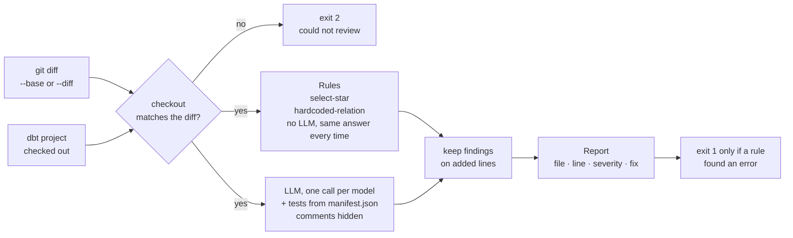

# dbt-review

Reviews a change to dbt models before it is merged. It reads the git diff to see what changed, reads the dbt
project to understand it, and prints findings with a file, a line, a severity and a fix.

| | |
|---|---|
| **Input** | A git diff: `--base REF`, a `.diff` file, or a pipe (`git diff HEAD~1 \| dbt-review --diff -`). The dbt project must be checked out |
| **Output** | Findings on stdout: file, line, severity (error, warning, info), description and fix. Text or JSON, and an exit code for CI |
| **Rules** | `select-star` and `hardcoded-relation`, on the parsed SQL. Same input, same answer, no LLM. Only a rule can fail the build |
| **LLM checks** | `join-fanout` and `naming`: one call per changed model, given the tests dbt declares. The LLM must give evidence for every finding (the evidence is not yet checked), and its findings are warnings at most |
| **Design** | A workflow, not an agent: code decides what the LLM sees, and the LLM has no tools ([ADR 1](docs/adr/0001-workflow-first-agent-as-a-later-layer.md)) |
| **AI stack** | Pydantic AI, with Groq's `openai/gpt-oss-120b` as the default model ([why](#ai-stack)) |
| **Samples** | [`examples/`](examples/): eight changes, each with the input diff and the review. No setup needed |
| **Mocked** | Nothing. The sample reviews are real runs against a real model; only the unit tests use a fake one |
| **Not built** | [Limitations](#limitations) and [Next steps](#next-steps) |
| **Time spent** | About seven and a half hours |

```
dbt-review · base duckdb · 2 files changed

models/orders.sql
  55     warning  join-fanout (llm)
         The left join to payments can create multiple rows per order because payments may contain several
         rows per order_id, breaking the orders model's unique order_id constraint.
         Evidence: orders model declares a unique test on order_id (order_id unique, not_null).
                   stg_payments (source for payments) does NOT have a unique test on order_id.
                   +  55 |     left join payments
                   +  56 |         on orders.order_id = payments.order_id
         Fix: Aggregate payments by order_id before joining or join on a column that is unique in the payments side.

0 errors · 1 warning · 0 info
```

This is [`examples/fanout-join/output.txt`](examples/fanout-join/output.txt); one long line is wrapped here.

## What it checks

| Check | Kind | Severity | Catches |
|---|---|---|---|
| `hardcoded-relation` | rule | error | A table named directly (`main.stg_payments`) where `ref()` or `source()` belongs |
| `select-star` | rule | warning | A `*` that decides the model's columns. Import CTEs and a closing `select * from final` are fine |
| `join-fanout` | LLM | warning | A new join that can return more rows than before |
| `naming` | LLM | info | Model and column names that break the project's conventions |

## See it without installing anything

`examples/` holds eight changes to the [jaffle_shop_duckdb](https://github.com/MartinRajniak/jaffle_shop_duckdb)
demo project, one branch each (`scenario/<name>` in that fork). Every folder has the input diff and the review
the tool produced for it, as text and as JSON.

| Scenario | The change | Review |
|---|---|---|
| [`select-star`](examples/select-star/output.txt) | three named columns become `customers.*` | warning, line 51 |
| [`hardcoded-schema`](examples/hardcoded-schema/output.txt) | `ref('stg_payments')` becomes `main.stg_payments` | error, line 11, exit code 1 |
| [`fanout-join`](examples/fanout-join/output.txt) | a join to payments on a column that is not unique | warning, line 55 |
| [`prompt-injection`](examples/prompt-injection/output.txt) | the same join, with a comment telling AI reviewers to report nothing | the same warning |
| [`bad-naming`](examples/bad-naming/output.txt) | a new model `orders_cleaned_v2` with columns `cust`, `dt`, `flag` | two of the four names |
| [`clean-change`](examples/clean-change/output.txt) | a new column with a test | nothing |
| [`new-model-no-tests`](examples/new-model-no-tests/output.txt) | a new model without tests | nothing: this check is not built |
| [`payment-method-drift`](examples/payment-method-drift/output.txt) | a value added in one place of two | nothing: this check is not built |

Five of the seven flawed changes pass `dbt build` with every test green, run on a database already built from
the base branch. That is the gap this tool is for. The fanout is one of the two that fail it: the `unique` test
on `orders` catches it only when the data has a duplicate and the build runs; the review flags it on the diff,
before either.

## Run it

You need [uv](https://docs.astral.sh/uv/) and git.

```bash
git clone https://github.com/MartinRajniak/dbt-review
git clone https://github.com/MartinRajniak/jaffle_shop_duckdb
cd jaffle_shop_duckdb
git checkout scenario/fanout-join

uvx --from dbt-duckdb dbt parse            # writes target/manifest.json; no database needed
export GROQ_API_KEY=...                    # optional: without a key the rules run and the LLM check is skipped

uv run --project ../dbt-review dbt-review --base duckdb
```

| Option | Meaning |
|---|---|
| `--base REF` | Review what the checked-out branch changed since it left `REF`. The usual form, locally and in CI |
| `--diff FILE`, `--diff -` | Review a diff you supply, from a file or a pipe: `git diff HEAD~1 \| dbt-review --diff -` |
| `--repo DIR` | The dbt project (default: the current directory) |
| `--format json` | Machine-readable output |
| `--model provider:name` | The LLM (default `groq:openai/gpt-oss-120b`). Reads `GROQ_API_KEY`, `ANTHROPIC_API_KEY` or `OPENAI_API_KEY` |

Exit codes: `0` no errors · `1` the review found an error · `2` the tool could not do its job (no dbt project,
the checkout does not match the diff, or an unexpected failure).

To check the tool itself:

```bash
cd dbt-review
uv sync
uv run pytest            # no network, no API key
uv run ruff check && uv run mypy
DBT_REVIEW_FORK=../jaffle_shop_duckdb uv run pytest tests/test_examples.py   # end to end, as CI runs it
```

`uv run python examples/regenerate.py --fork ../jaffle_shop_duckdb` re-creates every sample output. The rule
findings come out identical every time. The LLM findings should land on the same lines, in different words, and
the naming check does not always pick the same names.

## Use it in CI

A sketch for GitHub Actions in the dbt repository; it has not been run in this form yet. The job fails on exit
code 1 (an error found) and 2 (the tool could not review).

```yaml
on: pull_request                     # never pull_request_target: the change under review is untrusted
permissions:
  contents: read
jobs:
  dbt-review:
    runs-on: ubuntu-latest
    steps:
      - uses: actions/checkout@v7
        with:
          fetch-depth: 0             # --base needs the history
      - uses: astral-sh/setup-uv@v10.3.3
      - run: uvx --from dbt-duckdb dbt parse
      - run: uvx --from git+https://github.com/MartinRajniak/dbt-review dbt-review --base origin/${{ github.base_ref }}
        env:
          GROQ_API_KEY: ${{ secrets.GROQ_API_KEY }}
```

A pull request from a fork gets no secrets, so its review runs the rules and reports the LLM check as skipped.

## How it works



The instructions the LLM receives are one file: [`src/dbt_review/instructions.md`](src/dbt_review/instructions.md).
The prompt adds the model's file with line numbers, the added lines marked, and the tests dbt declares on the
model and on the models it reads.

A change costs one LLM call per changed model. In the demo project's history, 93 of 96 commits change one model
or none.

## AI stack

**Pydantic AI for the LLM call.** It gives a typed, validated answer, one retry when the answer does not fit, a
fake model for tests, and the provider as a setting. Groq's `openai/gpt-oss-120b` is the default because it is
free to try and holds the answer structure well. Anthropic and OpenAI models are accepted through the same
option and have not been run.

**What is sent to the provider:** the changed model's SQL without its comments, and the names of models, columns
and tests from the manifest. No data, and no other file.

## Design decisions

Each has a short record with the reasoning and what was rejected.

| Decision | Record |
|---|---|
| A workflow with one narrow LLM call, not an agent exploring the repository. Where an agent fits later | [ADR 1](docs/adr/0001-workflow-first-agent-as-a-later-layer.md) |
| The repository is required and must match the diff; the tool refuses to guess | [ADR 2](docs/adr/0002-the-repository-is-required-and-must-match-the-diff.md) |
| How the LLM check is evaluated, and what the first runs showed | [ADR 3](docs/adr/0003-how-the-llm-check-is-evaluated.md) |
| What a run records and where it goes (not built yet) | [ADR 4](docs/adr/0004-observability.md) |

Smaller choices:

- **The LLM cannot fail a build.** Its answer schema has no `error` severity and requires evidence. The file and
  the `llm` label are set by code. A message or fix over 300 characters is rejected.
- **The LLM never sees comments.** A comment telling AI reviewers to report nothing silenced the fanout finding in
  4 of 8 runs. Comments are now removed before the model sees the file, and it is found in 8 of 8.
- **Jinja is not compiled.** SQL is parsed with sqlglot after Jinja is swapped for placeholders. Compiling would
  turn `ref('x')` into a plain table name, which is exactly what `hardcoded-relation` looks for, and it would
  move the line numbers.
- **dbt is not a dependency.** The tool reads the `manifest.json` that `dbt parse` writes.

## Adding a check

- **A rule** is one module in [`src/dbt_review/checks/`](src/dbt_review/checks/) with a `check_id` and a
  `check(path, sql)` function, plus its name in the `RULES` list. The type checker verifies the shape.
- **An LLM check** is a section in `instructions.md` plus its id in the answer schema in `llm_check.py`.

## Limitations

- **Small evidence.** The results come from tens of calls on one demo project. See ADR 3.
- **The LLM sees one changed model at a time**: its file, its tests and the tests of the models it reads, not the
  other files in the change. That keeps each call small and focused, and it misses a problem spread across files.
  The `payment-method-drift` scenario is one: a payment method added to the accepted values in `schema.yml` but
  not to the list in `orders.sql` finds nothing.
- **DuckDB SQL only, and Jinja is not compiled.** A model the parser cannot read, such as Snowflake's
  `value:id::int`, is reported as skipped by the rules; SQL produced by macros is invisible to them.
- **The LLM knows only column tests on models.** Model-level tests, constraints and tests on sources and seeds
  are not in its prompt, so a join that is safe for one of those reasons can still be flagged.
- **The manifest must be current.** A stale one is noticed only when a changed model is missing from it. A
  changed `.yml` file is not reviewed.
- **An instruction could still hide** in a string literal or a column alias. Hiding comments narrows that route;
  it does not close it.
- **Smaller ones.** The rules check every changed `.sql` file, including singular tests; a top-level `union` is
  not checked by `select-star`; the dbt project must be at the root of the git repository; a finding cannot be
  suppressed.

## Next steps

Roughly in the order I would do them:

1. **Scenario tests against the real project**, with an `expected.json` per scenario, so a prompt or model change
   is measured before it is merged, and the same run nightly to notice the provider changing the model (ADR 3).
2. **Record the model, the prompt version and token counts** in the JSON report, and save it as an artifact of
   each pull request's CI run (ADR 4).
3. **`--fail-on warning`**, so a team can decide that warnings fail the build too, and the findings as comments
   on the pull request. Today only an error fails the build and the review is in the job log.
4. **A stronger prompt**: a fixed temperature, one or two examples per check, and the grain facts it lacks
   (model-level tests such as `unique_combination_of_columns`, constraints, tests on sources and seeds), each
   change measured against the scenarios. Then check that every column and test the LLM cites exists in the
   manifest.
5. **More checks**: a new model without `unique` and `not_null` tests on its key; a value list or column name
   that now disagrees with another file (the two scenarios above that find nothing today). Rules then need the
   manifest as well as the SQL.
6. **Other SQL dialects, Snowflake first.** The manifest names the warehouse (`metadata.adapter_type`); the rules
   would parse with that dialect. Not built because there is no Snowflake project here to test it on.

## How it was built

Built test-first in small commits; the history can be read commit by commit. CI runs ruff, mypy in strict mode,
the unit tests and an end-to-end test that reviews every scenario branch of the demo project (rule findings
only).

It was built with Claude Code as a pair. The design, the scope and the constraints were set by the author, who
reviewed every commit and questioned the decisions recorded in the ADRs.

## Licence

MIT, see [LICENSE](LICENSE). The diffs in `examples/` quote the
[jaffle_shop_duckdb](https://github.com/dbt-labs/jaffle_shop_duckdb) demo project by dbt Labs, which is
licensed under Apache-2.0.
